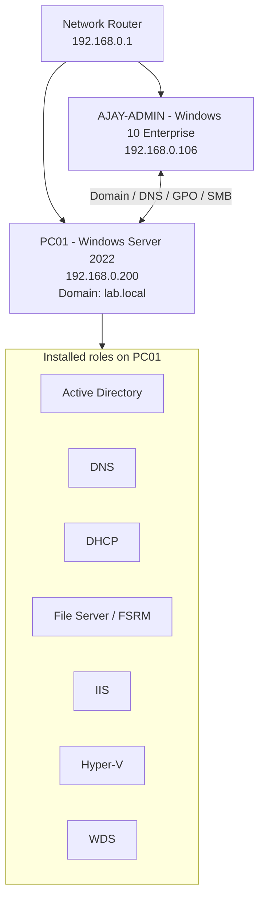

# ABC Technologies — Enterprise Windows Server 2022 Infrastructure

## Project Overview

This project demonstrates the design, implementation, configuration and testing of an enterprise-style Windows Server 2022 infrastructure for a fictional company named ABC Technologies.

The lab was built using two physical computers to demonstrate centralized identity management, network services, Group Policy, file sharing, server administration and client connectivity.

The following diagram represents the actual ABC Technologies lab environment.

## Lab Environment

| Component | Configuration |
|---|---|
| Server | PC01 |
| Server OS | Windows Server 2022 |
| Server IP | 192.168.0.200 |
| Domain | lab.local |
| Client | AJAY-ADMIN |
| Client OS | Windows 10 Enterprise 22H2 |
| Client IP | 192.168.0.106 |
| Network Gateway | 192.168.0.1 |

## Technologies and Roles

- Active Directory Domain Services (AD DS)
- DNS Server
- DHCP Server
- Group Policy Management
- File and Storage Services
- File Server Resource Manager (FSRM)
- SMB shares and NTFS permissions
- IIS Web Server
- Hyper-V
- Windows Deployment Services (WDS)
- Remote Desktop administration
- PowerShell

## Active Directory Implementation

Created an organizational structure for ABC Technologies with:

- HR
- Finance
- IT
- Sales
- Management
- Servers
- Groups
- Workstations
- Service Accounts

Created department-based security groups and sample domain user accounts.

## Group Policy

Implemented and verified the ABC workstation security baseline.

- Linked the workstation security GPO to the ABC workstation OU.
- Configured a 600-second workstation inactivity timeout.
- Verified policy application on the Windows 10 domain client.

## File Server Implementation

Created the company data structure:

- HR
- Finance
- IT
- Sales
- Management
- Public

Configured the ABCCompany$ SMB share, access-based enumeration and department-based NTFS permissions.

## DNS and DHCP

Configured DNS and DHCP services on Windows Server 2022.

- Created and inspected the lab.local DNS zone.
- Verified domain service records and domain controller discovery.
- Configured DHCP scopes and examined leases.

Note: DHCP scope exhaustion was identified during the final server health review and remains a documented limitation.

## IIS Web Server

Installed IIS and configured website hosting for the lab.

Performed troubleshooting of an HTTP 500.19 configuration error affecting the ClinicManagementSystem website.

The IIS site responded after a configuration correction, although full application functionality was not confirmed.

## Validation and Testing

The lab included testing and verification of:

- Domain membership and authentication
- Domain controller discovery
- DNS resolution
- Secure channel connectivity
- Group Policy application
- SMB share access
- Department group membership
- NTFS permissions
- IIS website response
- Remote Desktop connectivity

## Project Limitations

This project was built with two physical computers and one Windows Server domain controller.

The following advanced features were not fully implemented or verified:

- Additional domain controller and replication
- Read-Only Domain Controller (RODC)
- Domain trusts
- DFS replication
- NLB clustering
- Full RDS deployment
- Production Hyper-V virtual machine deployment
- Complete WDS deployment testing

Some installed roles were not fully configured. Server Manager also showed outstanding DHCP and SceCli warnings during the final review.

## Future Improvements

- Deploy a secondary domain controller.
- Configure and test AD replication.
- Correct DHCP address-pool exhaustion.
- Complete FSRM quota verification.
- Complete DFS Namespace and Replication.
- Deploy and test Hyper-V virtual machines.
- Complete WDS deployment testing.
- Improve IIS application functionality and HTTPS configuration.

## Learning Outcomes

This project provided practical experience in:

- Windows Server administration
- Active Directory management
- Group Policy configuration
- DNS and DHCP troubleshooting
- File server permissions
- IIS troubleshooting
- PowerShell administration
- Enterprise infrastructure documentation

## 📚 Project Resources

Explore the complete implementation and supporting evidence:

- 📄 [Complete Project Documentation](documentation/ABC-Technologies-Project-Documentation.docx)
- 🖼️ [Project Screenshots](screenshots/)
- 💻 [PowerShell Scripts](scripts/)
- 🏗️ [Architecture Files](architecture/)

## 🧪 Project Validation

The lab includes validation of:
- Active Directory domain connectivity
- DNS resolution and domain controller discovery
- Group Policy application
- Department-based file-share access
- Remote Desktop connectivity
- IIS configuration troubleshooting

See the project documentation for detailed results, limitations and future improvements.

## 📸 Project Screenshots

The following screenshots demonstrate the implementation and testing of the Windows Server 2022 lab.

### Active Directory and Group Policy

### DNS and DHCP

### File Server and IIS

See the [complete screenshot collection](screenshots/) for additional evidence.

## Disclaimer

This is an educational homelab project. It is not a production deployment. Configuration and testing claims are limited to the features actually implemented and verified.
